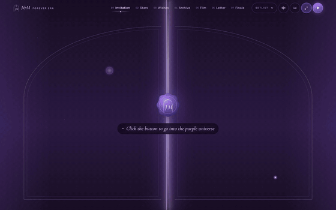
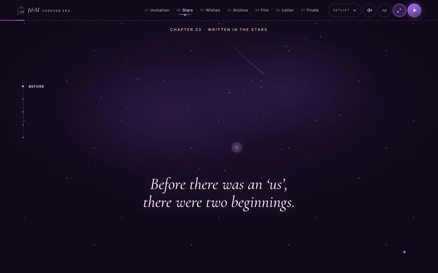
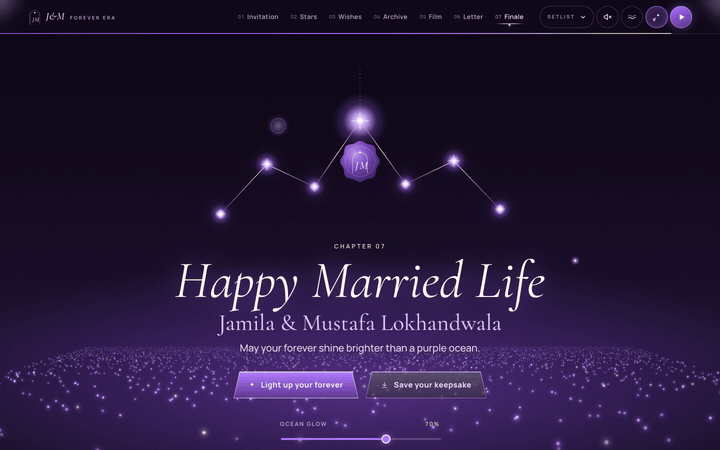
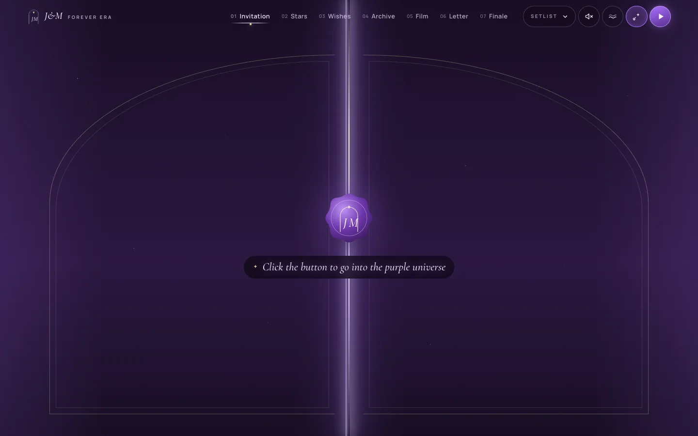
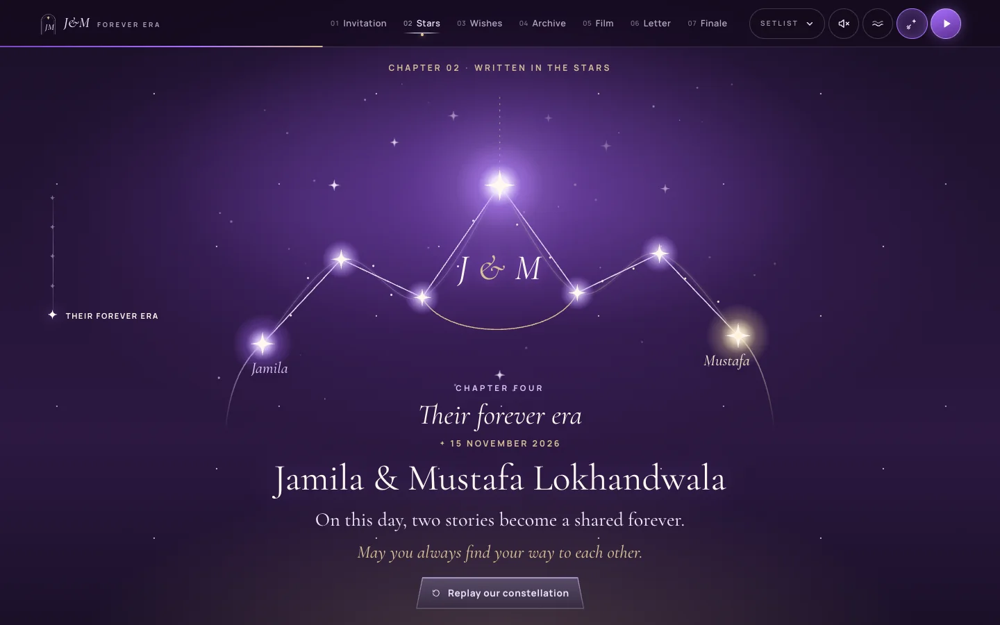
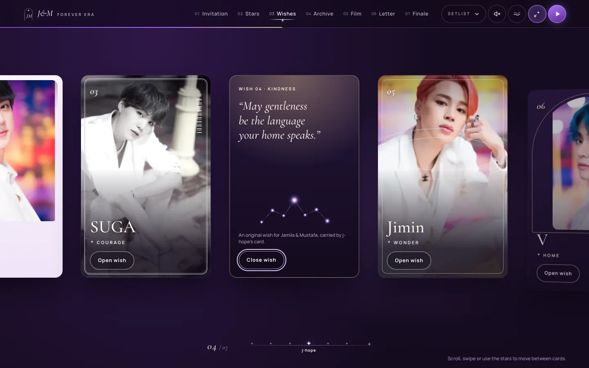
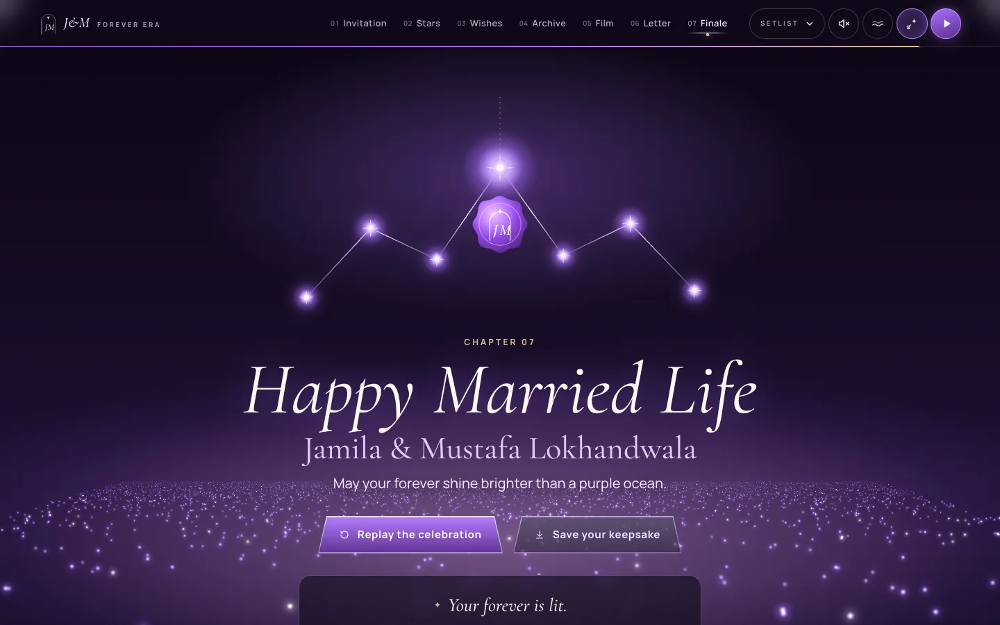
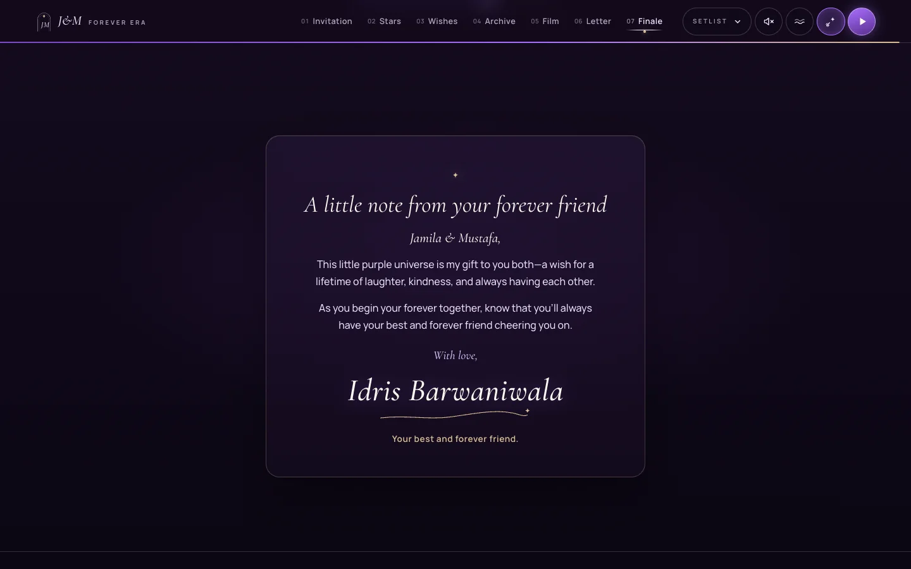
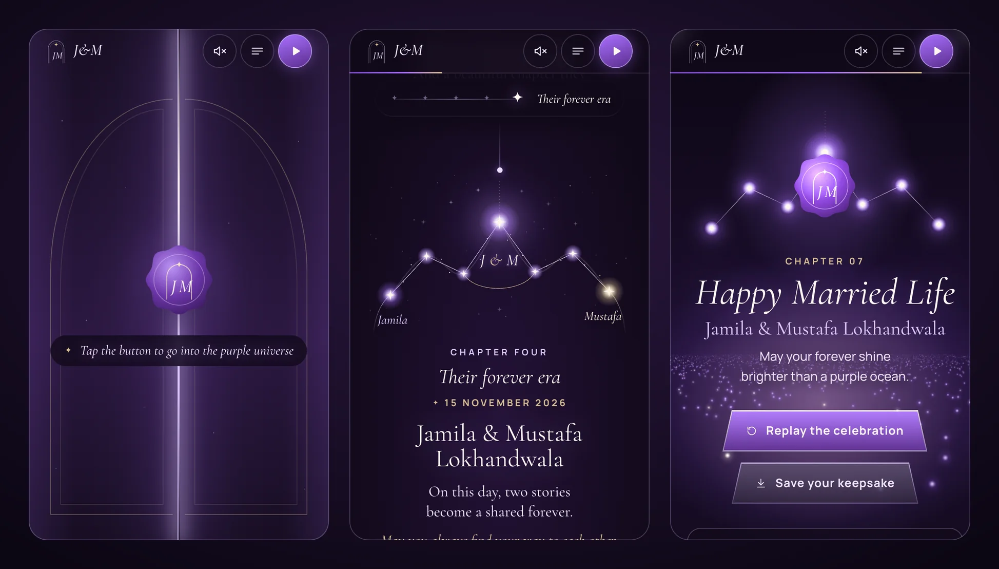

<div align="center">

# Their Forever Era

*A BTS-inspired wedding celebration for Jamila & Mustafa Lokhandwala.*

**[their-forever-era.netlify.app](https://their-forever-era.netlify.app)** · [The prompts behind it](PROMPTS.md) · [Media credits](MEDIA_CREDITS.md)


</div>

## The story behind the project

Idris Barwaniwala made this website as a wedding gift for his best and forever friends, Jamila and Mustafa, to celebrate their marriage on **15 November 2026**.

It is built like an evening at a BTS concert: purple stage light, a sea of lightsticks, seven members and seven wishes. The page opens on a closed door sealed with the couple's initials. Behind it, their story is told in stars, from Mustafa's first light and Jamila's to the day their paths meet. Seven photocards each carry a wish for their marriage. A purple archive of photographs, a short original film and a letter follow. In the finale, an ocean of light rises for them, and the page ends with a note from Idris.

It is a personal, unofficial fan tribute. Every wish and every line of the letter was written for Jamila and Mustafa; none of it is a quote from BTS.

## Visual preview

**Through the door.** The J&M seal is pressed, the doors swing open, and the names arrive over the photograph. A soft lightstick glow and a short star trail follow the pointer.



**Written in the Stars.** Scrolling plays the story: Mustafa's first light (28 November 1997), Jamila's (27 May 2002), their two paths curving together, and the constellation they make on 15 November 2026.



**Light up your forever.** In the finale, one press sends a burst of light through the constellation and a wave across the ocean of lights.



<table>
  <tr>
    <td width="50%"><br><sub><b>The door.</b> The site opens here; the wax seal is the way in.</sub></td>
    <td width="50%"><br><sub><b>Their forever era.</b> The last chapter of the story.</sub></td>
  </tr>
  <tr>
    <td width="50%"><br><sub><b>Seven wishes.</b> j-hope's card turned over to its wish.</sub></td>
    <td width="50%"><br><sub><b>The finale.</b> After “Light up your forever”.</sub></td>
  </tr>
  <tr>
    <td width="50%"><br><sub><b>A note from a forever friend.</b> Idris's dedication to the couple.</sub></td>
    <td width="50%"><br><sub><b>On a phone.</b> The door, the story's last chapter and the finale.</sub></td>
  </tr>
</table>

## What's on the page

**01 · The invitation.** A closed double door with a pulsing J&M wax seal. Pressing it swings both doors open in 3D. The names arrive letter by letter over a photograph of BTS, and the stage layers shift with the pointer. The soundtrack is optional and loads only when someone asks for it.

**02 · Written in the Stars.** A scroll-driven story in five chapters:

- An opening line.
- Mustafa's first light, 28 November 1997.
- Jamila's, 27 May 2002.
- Their paths curving toward each other.
- Their forever era, 15 November 2026.

On a computer the scene is pinned: stars travel along curved paths, lines draw themselves, the background drifts at different depths, the scroll settles on each chapter and reversing plays it backwards. A chapter rail jumps between chapters. Hovering, focusing or tapping either star shows its name and birth date. "Replay our constellation" returns to the start. On phones and in calm mode the same story is a vertical sequence with a sticky chapter bar.

**03 · Seven wishes for forever.** Seven photocards, one per member, each designed differently:

| Member | Theme |
| --- | --- |
| RM | Joy |
| Jin | Friendship |
| SUGA | Courage |
| j-hope | Kindness |
| Jimin | Wonder |
| V | Home |
| Jung Kook | Forever |

Each card turns over to an original wish. On a computer the row is pinned and scrolls sideways, settling on each card, with a seven-star progress bar. On touch screens it becomes a swipe carousel.

**04 · The purple archive.** 24 photographs in three tabs: Together, On Stage and Little Moments. They sit in a drag-and-swipe carousel with a full-screen viewer that also works with the arrow keys.

**05 · The film moment.** An original 12-second concert-light film made for the site. It either follows the scroll or plays normally, with play, mute and seek controls. Three official music videos follow: "Yet To Come", "Boy With Luv" and "Permission to Dance". Each one loads from YouTube's privacy-enhanced player only when it is played.

**06 · The letter.** An envelope closed with the J&M seal. Pressing the seal opens the wedding letter, and its paragraphs fade in one by one.

**07 · The finale.** Seven lights rise into the constellation over a WebGL ocean of 9,000 lights (3,200 on phones and low-power devices). "Light up your forever" sends a burst through the stars and a wave across the ocean, and a slider sets the ocean's glow. **"Save your keepsake" downloads a 1600 × 2000 PNG** of the couple's constellation, drawn in the browser.

**A note from your forever friend.** Idris's dedication, then the closing line of the page: *Made for my love, Jamila from his loving husband Mustafa*.

**Across the page:**

- **Play button.** The purple button in the top-right corner plays the whole page slowly, with music, so nobody has to scroll or click. It takes about four minutes. It opens the door, turns over every photocard, shows every gallery photo, plays the film, opens the letter and lights up the finale. Scrolling, tapping or pressing a key pauses it, and play carries on from wherever the page is.
- **Calm mode.** Calm mode follows the device's reduced-motion setting until the visitor changes it with the header button, and then remembers the choice. It turns off pinning, smooth scrolling, parallax, particles and travelling animations, and keeps every word and photo.
- **Responsive layouts.** Pinned, scroll-choreographed scenes are used on large screens with a mouse or trackpad. Touch screens and smaller windows get native scrolling, carousels and vertical sequences instead.
- **Keyboard and screen readers.**
  - Every main control can be reached with Tab, in page order.
  - Focus moves into opened cards, the letter and dialogs, and returns when they close.
  - The pinned story also exists as a text transcript for screen readers.
  - Status changes are announced politely.
- **Navigation.** A seven-track "setlist" lists every chapter: links in the header on wide screens, a dropdown in between, and a full-screen menu on phones. A progress line runs across the top. A link straight to a chapter (for example `…/#letter`) skips the door.
- **Link previews and privacy.** A share image and `og` tags give the link a proper preview in chats. A `noindex` tag asks search engines not to list the page. The site stores only each visitor's calm-mode and star-trail choices, in their own browser.

## Technology

| | |
| --- | --- |
| Framework | React 19.3 and TypeScript 7.0, built with Vite 8.3 |
| Animation | GSAP 3.15 with ScrollTrigger, SplitText, DrawSVG and MotionPath (through `@gsap/react`); Lenis 1.3 for smooth scrolling |
| Graphics | SVG for the constellations; hand-written WebGL shaders for the ocean of lights; Canvas 2D for the light burst, the star trail and the keepsake |
| Sound | Web Audio API, playing an original ambient loop with seamless crossfades |
| Styling | Plain CSS with custom properties (design tokens), no CSS framework; Cormorant Garamond and Manrope variable fonts, self-hosted through Fontsource |
| Media tools | sharp (WebP photos), ffmpeg-static (encoding the film and audio), playwright-core with Google Chrome (rendering the film's frames, the share image, the browser checks and this README's captures) |
| Hosting | Netlify, as a static site |

## Run locally

You need Node.js 20.19+ or 22.12+ (the site was built on Node 24) and npm. These commands were run in a fresh clone of this repository:

```sh
git clone https://github.com/IdrisBarwani/their-forever-era.git
cd their-forever-era
npm ci --ignore-scripts   # install exactly what package-lock.json lists
npm run dev               # development server at http://127.0.0.1:5173
npm run build             # type-check, then build the site into dist/
npm run preview           # serve the built site at http://127.0.0.1:4173
```

`--ignore-scripts` skips the one install script in the project: ffmpeg-static's download of an ffmpeg binary, which only the media scripts use. Netlify installs the same way.

**Environment variables.** Only one, and it is optional and not secret. `VITE_SITE_URL` is the published address, used for absolute link-preview tags. Copy `.env.example` to `.env` to set it locally. Without it, the build writes a relative preview image.

**Other scripts:**

| Command | What it does |
| --- | --- |
| `npm run typecheck` | TypeScript only |
| `npm run test:browser -- <url> <desktop\|calm\|mobile\|interactions\|all>` | Opens the site in headless Google Chrome and saves screenshots to `.screenshots/`. It fails on console errors, failed requests, horizontal overflow or broken interactions such as the door, story, photocards, gallery, film, letter, finale, keepsake download and play button. |
| `npm run docs:media -- <url>` | Re-captures the screenshots and GIFs in `docs/media/` from a running site |
| `npm run media:fetch` | Downloads the Wikimedia Commons photos, converts them to WebP and rewrites `src/config/media.generated.ts` and `MEDIA_CREDITS.md` |
| `npm run media:audio` / `media:film` / `media:share` | Renders the original soundtrack, the film, and the share image and icon |

The media, test and capture scripts need Google Chrome. `media:audio`, `media:film` and `docs:media` also need ffmpeg: run `npm rebuild ffmpeg-static` once to download it.

## Project structure

```text
their-forever-era/
├── index.html            Page shell: title, meta and link-preview tags, hero preload
├── public/               Served as-is: photos (WebP), film, soundtrack, favicon, share image
├── src/
│   ├── App.tsx           Page order and scrolling set-up
│   ├── config/           Names, dates and all copy (site.ts); media list; constellation layout
│   ├── scenes/           One component per section, in page order
│   ├── components/       Header, wax-seal button, star sky, play button, footer and more
│   ├── lib/              Scrolling, door, play-through, sound, WebGL ocean, keepsake
│   └── styles/           Design tokens and stylesheets
├── scripts/              Media pipeline, browser checks, README captures
├── docs/media/           The screenshots and GIFs in this README
├── netlify.toml          Netlify build settings
├── MEDIA_CREDITS.md      Author, licence and source of every photograph
└── PROMPTS.md            Every prompt sent to Kiro while making the site
```

## Personalization

- **Names, dates and every line of text** live in [`src/config/site.ts`](src/config/site.ts):
  - `COUPLE`: the couple's names.
  - `DATES`: the two birth dates and the wedding date.
  - `STORY`: the five chapters of "Written in the Stars".
  - `WISHES`: the seven photocard wishes.
  - `LETTER`, `FINALE` and `DEDICATION`: the letter, the finale and Idris's note.
  - `FOOTER`: the closing line.
  - `KEEPSAKE`: the downloadable image.
  - `GATE` and `TOUR`: the door and the play button.
- **Photographs.**
  - [`scripts/media-sources.mjs`](scripts/media-sources.mjs) lists the Wikimedia Commons files. `npm run media:fetch` downloads them and regenerates the manifest and the credits.
  - [`src/config/media.ts`](src/config/media.ts) decides which photo goes on each card and in each gallery tab.
- **The constellation**:
  - [`src/config/constellation.json`](src/config/constellation.json) holds the shared constellation, used by the story, the film, the finale and the keepsake.
  - [`src/lib/storyGeometry.ts`](src/lib/storyGeometry.ts) draws the story's paths.
- **Colours and type**: [`src/styles/tokens.css`](src/styles/tokens.css).
- **The play-through's pace**: how long it lingers on each moment and how fast it reads, set in [`src/lib/tour.ts`](src/lib/tour.ts).

## Deployment

The live site is **[their-forever-era.netlify.app](https://their-forever-era.netlify.app)**, a Netlify project in *IdrisBarwani's team*.

- **GitHub connection.** The Netlify project is linked to this repository's `main` branch. Netlify reads the repository with a read-only deploy key, and a GitHub webhook tells it about each push, so every push to `main` rebuilds and republishes the site.
- **Build settings** come from [`netlify.toml`](netlify.toml):
  - Build command `npm run build`.
  - Publish directory `dist`.
  - Node 24.
  - `NPM_FLAGS=--ignore-scripts`.
  - A one-year immutable cache for the fingerprinted files in `/assets/`.
- **Environment.** `VITE_SITE_URL=https://their-forever-era.netlify.app` is set in the Netlify project's environment variables. Nothing secret is needed.
- **No redirects.** The site is a single page whose chapters are `#` links, so it needs no redirect rules, and unknown paths return a real 404.

The site has no expiry date and no scheduled shutdown. It stays online for as long as the Netlify project exists.

## Prompt archive

**[PROMPTS.md](PROMPTS.md) holds every prompt behind this project**, word for word and in the order they were sent. Idris made the site with [Kiro](https://kiro.dev), an AI coding assistant. The prompts run from the first full brief to the constellation story, the dedication, the closed door, the play button and the publishing request. The file also says what it leaves out: Kiro's replies, approval clicks and one message Kiro generated itself.

## Credits and authorship

**Created by Idris Barwaniwala**, the best and forever friend of the bride and groom, Jamila and Mustafa Lokhandwala.

- **Photographs.** The 33 photographs are freely licensed files from Wikimedia Commons, under CC BY 3.0, CC BY 4.0, CC BY-SA 4.0, KOGL Type 1 or the public domain, resized to WebP. [MEDIA_CREDITS.md](MEDIA_CREDITS.md) credits each photographer and links each licence and source.
- **Music videos.** The three official music videos are embedded from [HYBE LABELS on YouTube](https://www.youtube.com/@HYBELABELS) and are not hosted here.
- **Original media.** The concert-light film, its score and the ambient soundtrack were made for this site by the scripts in `scripts/`.
- **Fonts.** Cormorant Garamond (Christian Thalmann) and Manrope (Mikhail Sharanda), both under the SIL Open Font License.

This is an unofficial, non-commercial fan tribute made for a wedding. It is not an official BTS production, and no endorsement by BTS, BIGHIT MUSIC or HYBE is implied. BTS, ARMY and related names belong to their owners.

**Testing.** The site was checked with the included browser scripts in Google Chrome on macOS, at desktop, tablet and phone sizes, and in calm mode. It has not been tested in Safari or Firefox, or on a physical phone.
